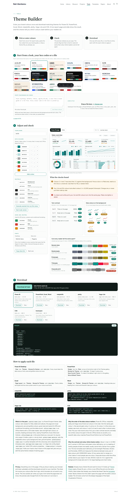
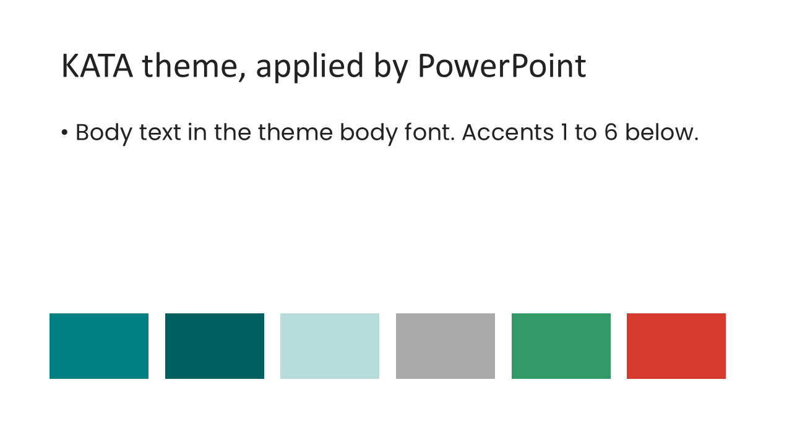
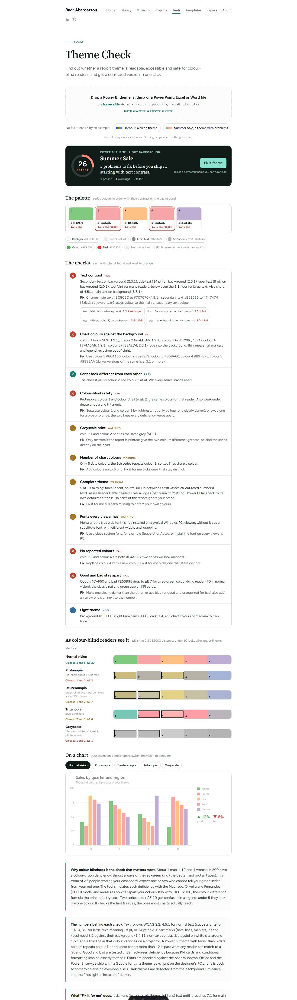

# theme-kit

Enter your brand colours once and get matching theme files for **Power BI, PowerPoint, Excel, Word, matplotlib, plotly, Vega-Lite and CSS**. Then check any theme for readability and colour-blind safety, and fix it in one click.

Use it in the browser, no install:

- **[Theme Builder](https://babarda.com/tools/theme-builder/)**: pick colours or one of 16 ready-made palettes, see a live Power BI page and slide, download one zip.
- **[Theme Check](https://babarda.com/tools/theme-check/)**: drop a Power BI theme, a `.thmx` or any `.pptx`, `.xlsx` or `.docx`, get a score out of 100, each problem with its fix, and a corrected theme.

Everything runs in your browser. No file is uploaded.



## What you get from one brand

| File | Opens in | How to apply |
|---|---|---|
| `powerbi/<name>.json` | Power BI Desktop | View > Themes > Browse for themes |
| `office/<name>.thmx` | PowerPoint, Word | Design > Themes > Browse for Themes |
| | Excel | Page Layout > Themes > Browse for Themes |
| `office/theme1.xml` | any Office file | swap `ppt/theme/theme1.xml` inside the zip (advanced) |
| `python/<name>.mplstyle` | matplotlib | `plt.style.use("<name>.mplstyle")` |
| `python/plotly-<name>.json` | plotly | `pio.templates["brand"] = go.layout.Template(json.load(f))` |
| `web/vega-lite-<name>.json` | Vega-Lite | pass as `config` |
| `web/<name>.css` | any web page | `var(--theme-series-1)` and the other `--theme-*` properties |
| `brand.json` | Theme Builder | drop it back on the page to edit later |

The `.thmx` carries a 16:9 slide master, so PowerPoint applies the background and text colours as well as the accents. Tested with PowerPoint, Excel and Word through COM on all 16 presets:



## What Theme Check looks at

| Check | Rule |
|---|---|
| Text contrast | WCAG 2.2: 4.5:1 for normal text, 3:1 for large text |
| Chart colours on the background | 3:1 (WCAG 1.4.11, non-text contrast) |
| Series look different | CIEDE2000 distance, warn under 10, fail under 5 |
| Colour-blind safety | same distance under protanopia, deuteranopia, tritanopia (Machado, Oliveira and Fernandes 2009) and greyscale |
| Good and bad apart | the red and green KPI pair under deuteranopia |
| Palette size, repeats | 6 to 12 data colours, no duplicate hex |
| Completeness | the Power BI roles and the 12 Office slots the file really sets |
| Fonts | flags fonts a viewer's PC probably does not have |

About 1 man in 12 and 1 woman in 200 have a colour-vision deficiency. In a meeting of 25 people, expect one or two who cannot tell two of your series apart.



## Use the engine in your own code

`src/themekit.js` is one ES module with no dependency. It works in the browser and in Node 18+.

```js
import { completeBrand, powerbiTheme, thmx, allFiles, zip, contrast, closestPairs } from "./src/themekit.js";

const brand = completeBrand({ name: "Acme", colors: ["#1F4E79", "#F39C12", "#27AE60"] });
const pbi = powerbiTheme(brand);            // Power BI theme object
const office = thmx(brand);                 // Uint8Array, write it to acme.thmx
const pack = zip(allFiles(brand));          // every file in one zip
contrast(brand.ink, brand.background);      // 17.9
closestPairs(brand.colors).deutan;          // { d, i, j }: the pair that collides for deuteranopia
```

Try it:

```bash
node examples/make-pack.mjs          # out/acme-theme-pack.zip
node examples/make-pack.mjs kata     # one of the 16 presets
```

`src/check.js` holds the audit (`inspect`, `audit`, `fixBrand`) used by Theme Check.

## The 16 presets

`presets/presets.json` holds the 16 design languages of the [Open Visualization Protocol](https://github.com/babarda/open-visualization-protocol) (AGRAW for board packs, KATA for weekly status decks, SENTINEL for control-room screens, and 13 more), built by `scripts/make-theme-presets.py` from [report-themes](https://github.com/babarda/report-themes).

## Repository

```
src/themekit.js       colour maths, file generators, zip reader and writer, file loaders
src/check.js          the audit and the fixer
presets/presets.json  16 ready-made brands
examples/             Node example
site/                 the two pages as they run on babarda.com (Astro)
docs/                 screenshots
```

## Related

- [Power BI project-controls templates](https://github.com/babarda/powerbi-project-templates): S-curve, milestones, RACI, 3-week look-ahead
- [Slide templates](https://babarda.com/templates/), each slide tagged by work area and palette, with a link that builds a theme from its colours

## Licence

MIT. By [Badr Abardazzou](https://babarda.com).
